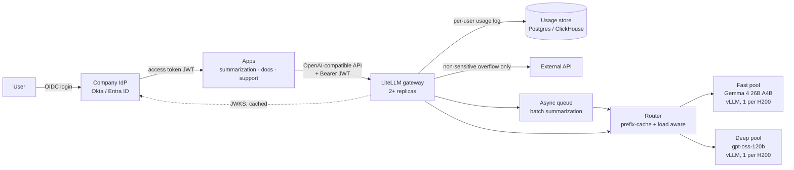

# Part 3 – Scaling to Production: 10,000 requests/min

**Target:** 10,000 req/min (≈167 req/s average) for summarization, document understanding and customer support. The service runs on vLLM with an open-source model, and quality has to match the external API it replaces.

**Recommendation:** **two model tiers on 3 nodes of 8× H200 (24 GPUs), one vLLM replica per GPU.** Gemma 4 26B A4B is the fast tier for quick summarization and document understanding; gpt-oss-120b is the deep-reasoning tier. A LiteLLM gateway sits in front, with a load-aware router behind it. The external API stays as overflow while the migration is in progress.

---

## 1. Proposed architecture

### Models: two tiers, routed by use case at the gateway

| Tier | Model | Why | Routes |
|---|---|---|---|
| **Fast** | **Gemma 4 26B A4B** (Apache 2.0) | MoE with 25B total and **3.8B active** parameters, so it has low latency at moderate load and a cheaper prefill. 256K context. **Image input**, so it reads scanned and PDF documents directly | Quick summarization, document understanding and extraction, support replies |
| **Deep** | **gpt-oss-120b** (Apache 2.0) | 117B total, 5.1B active; stronger multi-step reasoning, adjustable reasoning effort | Complex document analysis, multi-step questions, escalations from the fast tier |

The gateway routes by use case, and apps can request a tier explicitly. Each tier runs in its own GPU pool, and the split is set by measured traffic rather than fixed.

**The hybrid buys capability and latency, not capacity.** Using the simulator's resource model on the planning mix below (1,500 tokens in, 200 out, full batches), both tiers cost about the same: **~13.6 req/s per H200 for Gemma 4, ~13.1 for gpt-oss**.
- **Why they cost the same:** prefill dominates, and Gemma's sliding-window layers hold a large KV cache for each request's first 1K tokens.
- **Where Gemma wins:** lower latency at moderate load (a small batch reads only a slice of the expert weights), image input, and a cheaper prefill.
- **Where gpt-oss wins:** reasoning depth.
- **What this means for sizing:** the hardware below holds **for any traffic split** between the two tiers.

The simulator in Parts 1–2 models the fast tier: Gemma 4 26B A4B on 2× H200.

#### Deep tier: gpt-oss-120b

- **Why not a single small model:** the quality bar is the external API we're replacing. A small model handles support replies and short summaries, but is likely to fall short on complex multi-step document analysis. If quality drops, the migration fails no matter how cheap it is.
- **Big-model quality at small-model cost:**
  - It's a mixture-of-experts model with 117B total parameters but only about 5.1B active per token.
  - Per-token compute stays close to a small model's.
  - It fits on **one GPU** (about 61 GB in MXFP4), and vLLM support is mature.
- **Reasoning effort is set per route:** `low` for support and summarization, higher only where it pays off (see challenge #2).
- **Chosen by evaluation, not by size:**
  - Before committing, run a few hundred real prompts from the external API logs, with the API's outputs as references.
  - Score Gemma 4 26B A4B, gpt-oss-120b, **Muse Glimmer 30B** (Apache 2.0, multimodal; the challenger for the fast tier) and an 8B baseline.
  - For each use case, choose the smallest model that meets the quality bar. The gateway can then route each use case to a different model.
  - Muse Spark Open (816B) is left out for now: about 700 GB of VRAM, a license that needs legal review, and too new.

### Required hardware

**Sizing is based on tokens, not requests.** A 2,000-token document costs about 100× more than a support question.
- **Planning mix:** about **1,500 prompt tokens and 200 output tokens per request**, which is document-heavy. Our Dolly dataset averages about 90 in and 75 out, which would undersize the cluster.
- **Method:** the same resource model as the simulator. The table uses gpt-oss-120b's constants, the slightly more expensive tier, so it's a safe bound for any split:
  - weights about 61 GB
  - KV cache about 37 KB per token (only half the layers keep full attention)
  - prefill about 25k tok/s

| | H100 80GB | **H200 141GB** |
|---|---|---|
| KV cache room after weights | ~190k tokens (≈110 concurrent requests) | ~1.7M tokens (256 concurrent, the batch limit) |
| Throughput per GPU | ~10 req/s | ~14 req/s |
| GPUs needed at 100% busy | 16.4 | 12.2 |
| **Deployment** | 4 nodes × 8 = 32 GPUs | **3 nodes × 8 = 24 GPUs** |
| Normal load / one node lost | 51% / 68% busy | **51% / 76% busy** |

- **Why H200:** the extra HBM goes to KV cache, so each GPU can batch more requests and handle long documents.
- **Same cost, fewer nodes:** 24 H200s cost about as much as 32 H100s, and leave fewer nodes to operate.
- **One node can fail without needing the external API:** that's N+1 redundancy by itself.
- **H100 caveat:** H100 has no native MXFP4 support and uses a software fallback.
- **These numbers are estimates.** Before buying, benchmark one GPU with `vllm bench` on the real prompt mix and recalibrate the simulator.

**Pool split (starting point): each node runs 5 Gemma 4 replicas and 3 gpt-oss-120b replicas, so 15 fast + 9 deep across the cluster.**
- **Every node runs both pools,** so losing a node never takes out a tier.
- **Assuming about 70% of traffic on the fast tier:**

  | | Fast pool (15 GPUs) | Deep pool (9 GPUs) |
  |---|---|---|
  | Normal load | ~57% busy | ~42% busy |
  | One node lost | ~86% busy | ~64% busy |

- **Rebalancing:** any H200 can run either model, so the split changes by redeploying replicas, which takes minutes. In the meantime, the gateway can spill fast-tier traffic to the deep pool.

#### vLLM arguments per pool

Each Kubernetes pod is one replica on one H200. In production, the **router** balances across pods, so vLLM's `--data-parallel-size` isn't used. It's only used in the single-box simulator setup.

**Fast pool: Gemma 4 26B A4B**
```bash
vllm serve google/gemma-4-26B-A4B-it \
  --tensor-parallel-size 1 \
  --gpu-memory-utilization 0.90 \
  --max-num-seqs 256 \
  --max-model-len 131072 \
  --enable-chunked-prefill \
  --enable-prefix-caching \
  --async-scheduling \
  --limit-mm-per-prompt '{"image": 8}' \
  --reasoning-parser gemma4 \
  --served-model-name gemma4-fast
```
| Flag | Why |
|---|---|
| `--tensor-parallel-size 1` | ~50 GB of BF16 weights fits on one H200. One GPU per replica gives the best throughput per GPU and the smallest failure domain |
| `--gpu-memory-utilization 0.90` | ~72 GB left for KV cache |
| `--max-num-seqs 256` | Batch limit per replica, the same as the simulator |
| `--max-model-len 131072` | Long documents are cheap on Gemma's sliding-window KV (20 KiB/token past 1K tokens). The gateway caps this lower per route |
| `--enable-chunked-prefill` | Long document prefills don't stall token generation for the batch |
| `--enable-prefix-caching` | Shared system prompts and repeated documents skip prefill. The router's prefix affinity depends on it |
| `--async-scheduling` | Overlaps CPU scheduling with GPU execution |
| `--limit-mm-per-prompt '{"image": 8}'` | Scanned pages per request, for document understanding |
| `--reasoning-parser gemma4` | Separates thinking from the answer when thinking is enabled |

For support tooling that uses function calling, add `--tool-call-parser gemma4 --enable-auto-tool-choice` with the Gemma 4 tool chat template from the vLLM recipe.

**Deep pool: gpt-oss-120b**
```bash
vllm serve openai/gpt-oss-120b \
  --tensor-parallel-size 1 \
  --gpu-memory-utilization 0.90 \
  --max-num-seqs 256 \
  --max-model-len 131072 \
  --max-num-batched-tokens 8192 \
  --max-cudagraph-capture-size 2048 \
  --stream-interval 20 \
  --enable-prefix-caching \
  --async-scheduling \
  --tool-call-parser openai --enable-auto-tool-choice \
  --served-model-name gpt-oss-deep
```
| Flag | Why |
|---|---|
| `--tensor-parallel-size 1` | ~61 GB of MXFP4 weights fits on one H200. The vLLM recipe says TP=1 gives the best throughput per GPU |
| `--max-model-len 131072` | gpt-oss's full 128K context |
| `--max-num-batched-tokens 8192` | Tokens per scheduler step, from vLLM's Hopper recipe. It bounds how much prefill one step can carry, protecting decode latency |
| `--max-cudagraph-capture-size 2048` | From the Hopper recipe: CUDA graphs cover large batches, which lowers per-step overhead |
| `--stream-interval 20` | From the Hopper recipe: sends streamed tokens in groups of 20, which lowers CPU overhead at high concurrency |
| `--enable-prefix-caching` | **Kept on, deliberately.** vLLM's Hopper recipe turns it off for benchmarking, but our router depends on prefix affinity for shared documents. Benchmark both settings on the real mix |
| `--tool-call-parser openai --enable-auto-tool-choice` | Native function calling for support tooling |

**Reasoning effort** isn't a server flag. The gateway sets `reasoning_effort` per request and per route: `low` by default (challenge #2).

**Supporting hardware:**
- **Network:** 100–200 GbE is enough. Each replica runs on one GPU, so there's no traffic between GPUs, and InfiniBand isn't needed.
- **Storage:** local NVMe on each node caches the weights, so a replica starts in seconds instead of downloading about 61 GB.
- **CPU:** a small CPU node pool runs the gateway, router and monitoring.

### Request flow: application → inference cluster



1. **User → app (OAuth 2.0 / OIDC):** users sign in to the app through the company identity provider (Okta or Entra ID).
   - **User-facing calls:** the app forwards the user's **access token (JWT)** to the gateway. When the app calls on the user's behalf from a backend, it exchanges the token on-behalf-of the user (RFC 8693), so the user's identity is kept.
   - **Batch jobs with no user:** these authenticate as a **service identity** (OAuth client credentials).
   - **No shared static keys:** every request carries a verifiable identity.
2. **App → gateway:** the app calls the **LiteLLM gateway** through one OpenAI-compatible API, so apps don't change when the model changes.
3. **Gateway:**
   - **validates the JWT locally:** signature checked against the identity provider's **cached JWKS** (its published signing keys), plus `aud` and `exp`
   - extracts **user (`sub`), team (group claim) and app (`azp`)**
   - LiteLLM's JWT auth does this. If that tier isn't licensed, a JWT filter at an Envoy or API gateway layer in front of it does the same job and passes the identity on as headers.
   - enforces **per-user and per-team** quotas and rate limits
   - assigns a priority: interactive support ranks above document understanding, which ranks above batch summarization
   - picks the model and route for the use case
   - enforces the **compliance rule:** requests tagged sensitive never go to the external API
4. **Async traffic:** batch summarization that isn't time-sensitive goes to a **queue** and is processed when there's capacity.
5. **Router → replica:** the **router** (vLLM production-stack router or llm-d) picks a vLLM replica.
6. **vLLM** runs the request with chunked prefill, prefix caching and FP8 KV cache. It returns the output with exact token `usage`, from the model's own tokenizer.
7. **Usage record:** on the way back, the gateway writes one record per request with **user, team, app, route, model, prompt and completion tokens, latency, status and cost**.

### Load balancing strategy

- **Not round-robin:** requests differ in cost by 100×, so spreading them evenly by count leaves replicas unevenly loaded.
- **Least-loaded first:** the router picks by live **queue depth and KV cache usage**, read from each replica's metrics.
- **Prefix-cache affinity:** requests sharing a prefix (the same system prompt or the same document) go to the replica that already holds it in KV cache. That skips the repeated prefill, which is the expensive part of this workload.
- **Priority:** the gateway enforces priority, so batch work can't starve interactive traffic.
- **One replica per GPU:** the whole model fits on one GPU, so there's no splitting across GPUs. That gives the best throughput per GPU, and one failure takes down only 1/24 of capacity.

### Observability pipeline

- **Metrics:**
  - sources: vLLM `/metrics` (the same metrics as our simulator), the DCGM exporter (GPU clocks, temperature, memory, XID/ECC errors) and the gateway (per team, per route, overflow and fallback rates)
  - collected by **Prometheus**, with Mimir for HA and long retention
  - shown in **Grafana**: the simulator dashboard plus a per-replica view
  - routed through **Alertmanager** to PagerDuty and Slack
- **Per-user usage:** the authenticated identity from the gateway makes per-user usage visible.
  - **Usage store:** one record per request (user, team, app, model, tokens, latency, cost, `finish_reason`) in Postgres or ClickHouse. LiteLLM's spend logs work for this.
  - **Usage views:** Grafana shows usage per user, team and app, and drives chargeback, quota enforcement and abuse detection, such as one user running a script that burns 30% of GPU time.
  - **The user ID never becomes a Prometheus label.** Thousands of users would mean thousands of time series and overload Prometheus. Prometheus keeps low-cardinality labels (team, app, route); per-user detail lives in the usage store and logs.
- **Logs:** structured per-request logs from the gateway (request ID, user ID, team, model, tokens, latency, `finish_reason`) go to Loki.
  - **They contain no prompt or output text**, for compliance.
  - The user is identified by the pseudonymous `sub` claim, not an email address.
  - Access to usage data is role-restricted and has a set retention period.
- **Tracing:** OpenTelemetry traces app → gateway → router → vLLM, so one slow request can be traced to queueing, prefill or decode.
- **SLOs:** p95 TTFT, p95 TPOT and success rate per route. Alerting is based on how fast the error budget is used up.
- **Cost:** a cost-per-million-tokens dashboard compared against the old API bill. That's the business case, measured.

---

## 2. Scaling challenges and proposed solutions

| # | Challenge | Solution |
|---|---|---|
| 1 | **Prefill dominates.** Long documents take about 60 ms of GPU time each, and big prefills stall token generation for everyone sharing the batch | Chunked prefill; prefix caching for shared documents and system prompts; a separate replica pool for long documents vs. interactive traffic; later, split prefill and decode onto separate GPUs (disaggregation) |
| 2 | **Reasoning tokens inflate output.** gpt-oss "thinks" before answering, and high reasoning effort can multiply output tokens | Reasoning effort set per route at the gateway (`low` by default); track output tokens per request by route; cap `max_tokens` |
| 3 | **KV cache pressure** from long contexts reduces how many requests fit in a batch | H200 memory; FP8 KV cache; a `max_model_len` limit per route; alert on preemptions and on KV usage above 90% |
| 4 | **Uneven load** across replicas | Load-aware, prefix-aware routing (above) |
| 5 | **Slow scale-up.** A new GPU node takes minutes to start, and the weights are about 61 GB | Scale on queue depth and KV usage, not CPU; keep warm headroom (51% normal load); pre-pulled images and weights cached on NVMe; reserved capacity for the base load |
| 6 | **Noisy neighbours** between teams | Per-team quotas, priority classes, and separate pools if one team's traffic shape hurts others |
| 7 | **Model and config upgrades** | Canary releases through weighted routing at the gateway, gated by the evaluation suite; pinned model versions; the previous version kept deployable for rollback |
| 8 | **Auth on the critical path.** At 167 req/s, calling the identity provider per request adds latency and makes the provider a single point of failure | Validate JWTs locally against cached JWKS, with no identity provider call per request. Refresh signing keys in the background, so an identity provider outage doesn't stop inference until tokens expire. Use short-lived tokens of about 15 minutes |
| 9 | **Traffic growth** beyond 10k/min | Add nodes, since replicas are independent and capacity grows linearly. Recalibrate the simulator with production metrics to plan each step |

---

## 3. Reliability

### Spikes that were previously absorbed by external APIs

The external API used to provide effectively unlimited burst capacity. A fixed GPU cluster doesn't, so spikes are handled in layers, cheapest first:

1. **Headroom:** normal load runs at about 51% GPU busy, so routine spikes of up to about 2× fit without any action.
2. **Shift and shed by priority:**
   - batch summarization moves to the async queue and is processed after the spike
   - interactive support keeps its latency SLO
3. **Overflow to the external API:** when cluster TTFT or queue depth crosses a threshold, the gateway sends **non-sensitive** traffic to the external provider. Keep that contract as a burst tier during migration. Sensitive traffic is never sent outside; it queues instead.
4. **Admission control:** past that point, return `429` with `Retry-After`, as the simulator does, instead of letting queues and latency grow without bound.
5. **Autoscaling** adds nodes for sustained growth. It's too slow for spikes lasting seconds, which steps 1–4 handle.

### Partial GPU failure

- **Detection:**
  - vLLM `/health`, plus DCGM XID and ECC errors
  - the request error rate of each replica
- **Isolation:** the router removes the failed replica within seconds. With one replica per GPU, losing a GPU means losing 1/24 of capacity.
- **Retries:**
  - the gateway retries failed requests once on another replica
  - for streaming requests, only if no tokens were sent yet
  - this is safe because generation has no side effects
- **Recovery:** Kubernetes reschedules the replica onto a healthy GPU, and nodes with hardware faults are cordoned and drained.
- **Blast radius:** replicas are spread across all 3 nodes, with PodDisruptionBudgets. **Losing a whole node** leaves 16 GPUs at about 76% busy: still within SLO, with no external API needed.

### Degraded model performance

**Slow, but still answering.** Causes include thermal throttling, a bad driver or kernel, or a misconfigured replica.
- Compare each replica's TPOT and tokens per second against the fleet median.
- Watch DCGM clock and temperature metrics.
- Automatically remove outlier replicas from rotation and investigate. A slow replica hurts the p95 of every request routed to it.

**Worse output quality.** Causes include a new model, a quantization or config change, a reasoning-effort change, or a shift in incoming traffic.
- **Before rollout:** run the golden-set evaluation in CI for every model or config change.
- **During rollout:** canary 5% of traffic. Roll back automatically on these signals:
  - evaluation scores on sampled traffic
  - user thumbs-down rate
  - the rate of empty or truncated output
  - the `finish_reason=length` rate
  - refusal rate
- **During migration:** shadow a sample of non-sensitive traffic against the external API and compare the answers. This is the evidence that the self-hosted model really matches quality.
- **Fallback:** for a route whose quality alert fires, the gateway can send it back to the previous model version, or to the external API for non-sensitive traffic, without redeploying anything.
